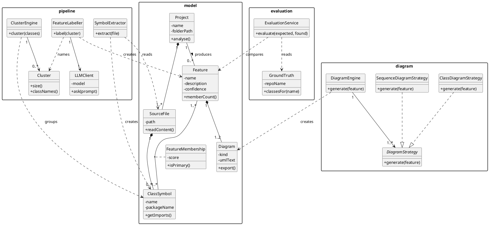

# AI-Assisted System Architecture & Feature Identification Pipeline
## Technical Design, Object Model, and AI Engine Specifications

---

### 1. Architectural Vision
The primary innovation of the **AI-Assisted UMLRev** system (conceived by Jay Gandhi & Aditya Rane) is replacing the manual feature-tagging prerequisite with an automated **AI-Driven Static & Semantic Analysis Pipeline**. 

Rather than requiring a developer to hand-annotate hundreds of test scenarios or execution traces, the system:
1. Performs static source-code symbol extraction (AST parsing).
2. Computes structural and semantic affinities between classes to form cohesive feature clusters.
3. Uses a Large Language Model (LLM) to infer functional business feature names, descriptions, and confidence metrics.
4. Generates feature-scoped UML diagrams via pluggable diagram strategies.
5. Provides an evaluation service comparing AI predictions against architectural ground truth.

---

### 2. High-Level Pipeline Architecture

```
┌────────────────────────────────────────────────────────────────────────────────────────┐
│                              AI-ASSISTED UMLREV PIPELINE                               │
├────────────────────────────────────────────────────────────────────────────────────────┤
│                                                                                        │
│  [Source Files / Repo]                                                                 │
│           │                                                                            │
│           ▼                                                                            │
│  ┌────────────────────────┐                                                            │
│  │    SymbolExtractor     │ ──> Parses AST, extracts ClassSymbols, imports, methods    │
│  └────────────────────────┘                                                            │
│           │                                                                            │
│           ▼                                                                            │
│  ┌────────────────────────┐                                                            │
│  │     ClusterEngine      │ ──> Groups cohesive ClassSymbols into candidate Clusters   │
│  └────────────────────────┘                                                            │
│           │                                                                            │
│           ▼                                                                            │
│  ┌────────────────────────┐                                                            │
│  │     FeatureLabeller    │ <──> Queries LLMClient (Gemini / GPT) with cluster context │
│  └────────────────────────┘                                                            │
│           │                                                                            │
│           ▼                                                                            │
│  ┌────────────────────────┐                                                            │
│  │   Human-in-the-Loop    │ ──> Developer reviews, adjusts, or approves features       │
│  │      Review Gate       │     via the interactive Web Dashboard                      │
│  └────────────────────────┘                                                            │
│           │                                                                            │
│           ▼                                                                            │
│  ┌────────────────────────┐                                                            │
│  │     DiagramEngine      │ ──> Applies ClassDiagramStrategy & SequenceDiagramStrategy │
│  └────────────────────────┘                                                            │
│           │                                                                            │
│           ▼                                                                            │
│  [UML Class & Sequence Diagrams] + [Downloadable PlantUML Diagram-as-Code]             │
│                                                                                        │
└────────────────────────────────────────────────────────────────────────────────────────┘
```

---

### 3. Detailed Class & Package Design (From Lab Exp 5)

The object-oriented design is cleanly structured into four decoupled packages:

```
┌────────────────────────────────────────────────────────────────────────────────────────┐
│                                PACKAGE ORGANIZATION                                    │
├──────────────────────┬──────────────────────┬───────────────────┬──────────────────────┤
│      1. model        │     2. pipeline      │    3. diagram     │    4. evaluation     │
├──────────────────────┼──────────────────────┼───────────────────┼──────────────────────┤
│ Project              │ SymbolExtractor      │ DiagramEngine     │ GroundTruth          │
│ SourceFile           │ ClusterEngine        │ DiagramStrategy   │ EvaluationService    │
│ ClassSymbol          │ Cluster              │ ClassDiagramStrat │                      │
│ Feature              │ FeatureLabeller      │ SequenceDiagramSt │                      │
│ FeatureMembership    │ LLMClient            │                   │                      │
│ Diagram              │                      │                   │                      │
└──────────────────────┴──────────────────────┴───────────────────┴──────────────────────┘
```

#### Package 1: `model` (Domain Core)
- **[`Project`](file:///c:/Users/Aditya%20Rane/OneDrive/Desktop/aditya/College%20MPSTME/sem5/SE/Project/B124_B129_Exp5.pdf):** Represents the uploaded or cloned software repository.
  - Attributes: `- name: String`, `- folderPath: String`
  - Methods: `+ analyse(): void`
- **[`SourceFile`](file:///c:/Users/Aditya%20Rane/OneDrive/Desktop/aditya/College%20MPSTME/sem5/SE/Project/B124_B129_Exp5.pdf):** Encapsulates an individual source file (`.java`, `.ts`, `.py`).
  - Attributes: `- path: String`
  - Methods: `+ readContent(): String`
- **[`ClassSymbol`](file:///c:/Users/Aditya%20Rane/OneDrive/Desktop/aditya/College%20MPSTME/sem5/SE/Project/B124_B129_Exp5.pdf):** Represents an extracted class or interface within a file.
  - Attributes: `- name: String`, `- packageName: String`
  - Methods: `+ getImports(): List<String>`
- **[`Feature`](file:///c:/Users/Aditya%20Rane/OneDrive/Desktop/aditya/College%20MPSTME/sem5/SE/Project/B124_B129_Exp5.pdf):** A cohesive functional unit detected by AI or adjusted by the developer.
  - Attributes: `- name: String`, `- description: String`, `- confidence: Float`
  - Methods: `+ memberCount(): Integer`
- **[`FeatureMembership`](file:///c:/Users/Aditya%20Rane/OneDrive/Desktop/aditya/College%20MPSTME/sem5/SE/Project/B124_B129_Exp5.pdf):** Association class linking classes to features.
  - Attributes: `- score: Float` (confidence of membership)
  - Methods: `+ isPrimary(): Boolean`
- **[`Diagram`](file:///c:/Users/Aditya%20Rane/OneDrive/Desktop/aditya/College%20MPSTME/sem5/SE/Project/B124_B129_Exp5.pdf):** Rendered or textual UML representation.
  - Attributes: `- kind: String` (Class vs Sequence), `- umlText: String` (PlantUML markup)
  - Methods: `+ export(): File`

#### Package 2: `pipeline` (AI & Static Analysis)
- **[`SymbolExtractor`](file:///c:/Users/Aditya%20Rane/OneDrive/Desktop/aditya/College%20MPSTME/sem5/SE/Project/B124_B129_Exp5.pdf):** Inspects AST of `SourceFile` instances to yield `ClassSymbol` instances.
  - Methods: `+ extract(file: SourceFile): List<ClassSymbol>`
- **[`ClusterEngine`](file:///c:/Users/Aditya%20Rane/OneDrive/Desktop/aditya/College%20MPSTME/sem5/SE/Project/B124_B129_Exp5.pdf):** Applies graph community detection or vector embedding clustering to group classes into candidate feature sets.
  - Methods: `+ cluster(classes: List<ClassSymbol>): List<Cluster>`
- **[`Cluster`](file:///c:/Users/Aditya%20Rane/OneDrive/Desktop/aditya/College%20MPSTME/sem5/SE/Project/B124_B129_Exp5.pdf):** In-memory grouping of closely related class names.
  - Methods: `+ size(): Integer`, `+ classNames(): List<String>`
- **[`FeatureLabeller`](file:///c:/Users/Aditya%20Rane/OneDrive/Desktop/aditya/College%20MPSTME/sem5/SE/Project/B124_B129_Exp5.pdf):** Formulates contextual prompts describing the cluster's classes, methods, and call paths, invoking the LLM to deduce the business feature name and description.
  - Methods: `+ label(cluster: Cluster): Feature`
- **[`LLMClient`](file:///c:/Users/Aditya%20Rane/OneDrive/Desktop/aditya/College%20MPSTME/sem5/SE/Project/B124_B129_Exp5.pdf):** Decoupled API wrapper handling communication with LLM backends (Gemini, Claude, GPT).
  - Attributes: `- model: String`
  - Methods: `+ ask(prompt: String): String`

#### Package 3: `diagram` (Strategy-Based UML Generation)
- **[`DiagramEngine`](file:///c:/Users/Aditya%20Rane/OneDrive/Desktop/aditya/College%20MPSTME/sem5/SE/Project/B124_B129_Exp5.pdf):** Invokes registered strategies to synthesize diagrams for an approved `Feature`.
  - Methods: `+ generate(feature: Feature): List<Diagram>`
- **[`DiagramStrategy`](file:///c:/Users/Aditya%20Rane/OneDrive/Desktop/aditya/College%20MPSTME/sem5/SE/Project/B124_B129_Exp5.pdf) (Interface):** Defines the contract for diagram generators (**Strategy Pattern**).
  - Methods: `+ generate(feature: Feature): Diagram`
- **[`ClassDiagramStrategy`](file:///c:/Users/Aditya%20Rane/OneDrive/Desktop/aditya/College%20MPSTME/sem5/SE/Project/B124_B129_Exp5.pdf):** Concrete strategy synthesizing structural UML class diagrams.
- **[`SequenceDiagramStrategy`](file:///c:/Users/Aditya%20Rane/OneDrive/Desktop/aditya/College%20MPSTME/sem5/SE/Project/B124_B129_Exp5.pdf):** Concrete strategy synthesizing behavioral UML sequence diagrams.

#### Package 4: `evaluation` (Empirical Benchmarking)
- **[`GroundTruth`](file:///c:/Users/Aditya%20Rane/OneDrive/Desktop/aditya/College%20MPSTME/sem5/SE/Project/B124_B129_Exp5.pdf):** Contains expert-annotated architectural feature mappings for benchmark projects.
  - Attributes: `- repoName: String`
  - Methods: `+ classesFor(name: String): List<String>`
- **[`EvaluationService`](file:///c:/Users/Aditya%20Rane/OneDrive/Desktop/aditya/College%20MPSTME/sem5/SE/Project/B124_B129_Exp5.pdf):** Calculates Precision, Recall, and F1-Score of AI-identified features against Ground Truth.
  - Methods: `+ evaluate(expected: GroundTruth, found: List<Feature>): EvaluationMetrics`

---

### 4. Applied Design Patterns
1. **Strategy Pattern (`DiagramEngine` & `DiagramStrategy`):**
   Decouples diagram generation logic from the core pipeline. Adding new diagram types (e.g., State Machine, Component, Deployment) requires creating a new strategy class implementing `DiagramStrategy` without modifying `DiagramEngine`.
2. **Association Class Pattern (`FeatureMembership`):**
   A class may participate in more than one feature (cross-cutting concern). `FeatureMembership` models this m:n relationship with an explicit confidence score and primary flag (`isPrimary()`).
3. **Pipeline / Filter Pattern (`pipeline` package):**
   Raw files pass sequentially through extraction -> clustering -> labeling -> human review -> generation. Each stage produces well-typed intermediate representations.
4. **Adapter / Gateway Pattern (`LLMClient`):**
   Decouples the labeling engine from specific LLM vendors (OpenAI, Google Gemini, Anthropic, or local models like Ollama).

---

### 5. PlantUML Source Code for the Architecture
As documented in [B124_B129_Exp5.pdf](file:///c:/Users/Aditya%20Rane/OneDrive/Desktop/aditya/College%20MPSTME/sem5/SE/Project/B124_B129_Exp5.pdf) and [B124_B129_Exp5.docx](file:///c:/Users/Aditya%20Rane/OneDrive/Desktop/aditya/College%20MPSTME/sem5/SE/Project/B124_B129_Exp5.docx):


