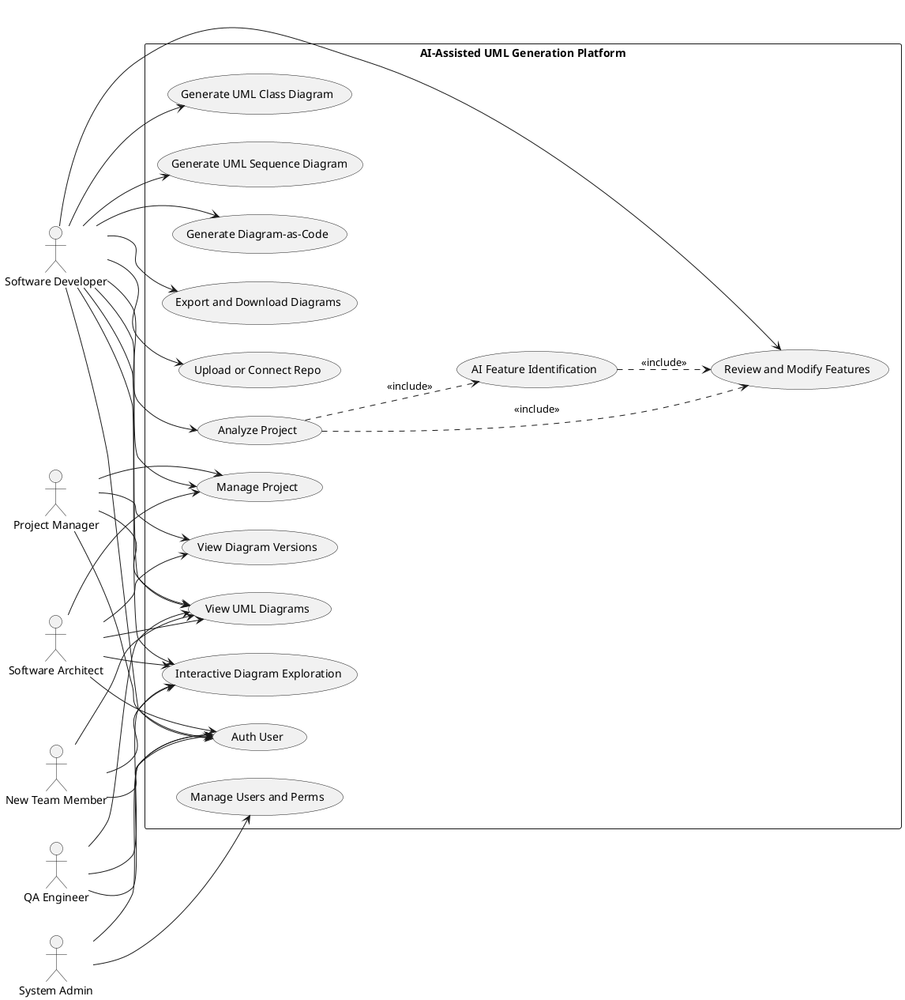
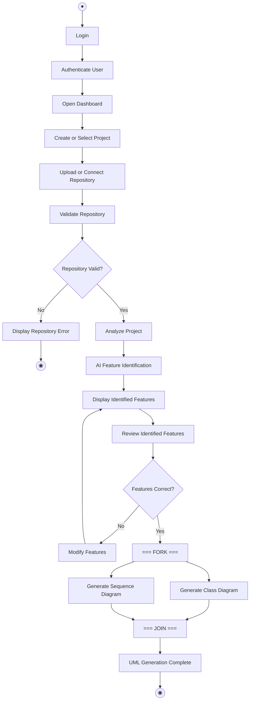
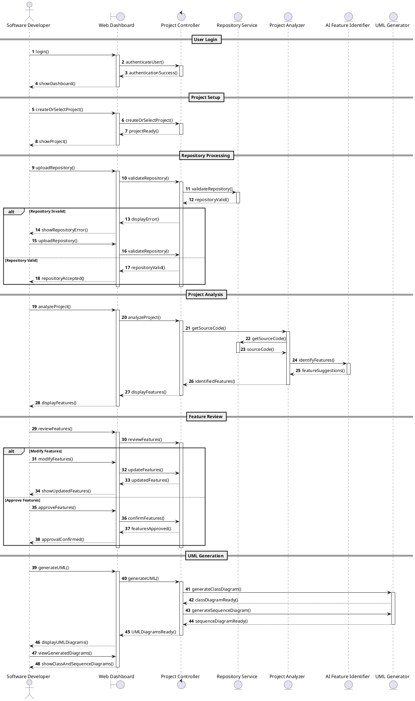
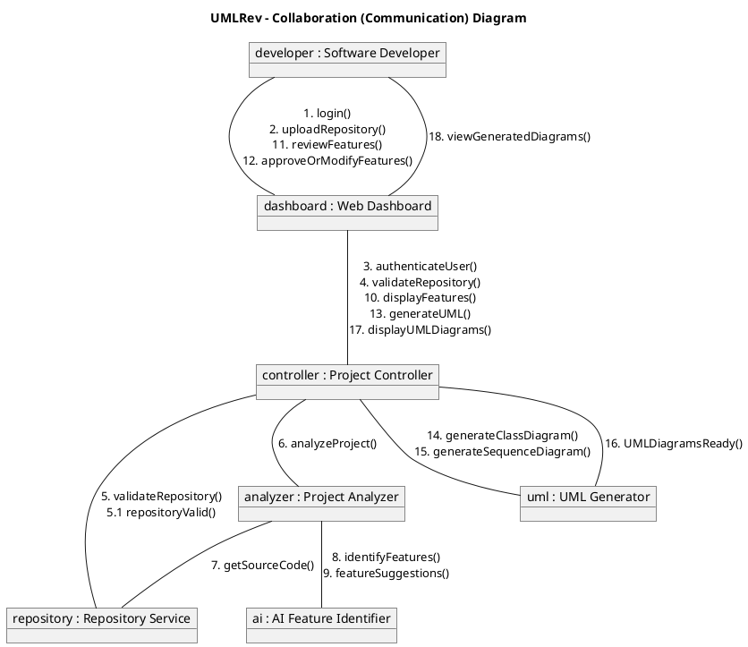
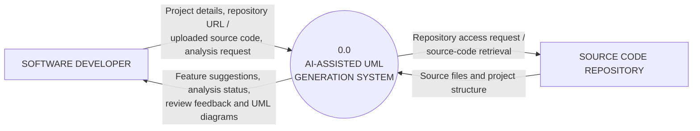

# Complete UML and Data Flow Models (DFD)
## Comprehensive Diagram Specifications, Traceability, and Markup

This document consolidates all architectural and behavioral modeling artifacts created for the **AI-Assisted UMLRev** project across Software Engineering Lab Experiments 3 through 8.

---

## 1. Use Case Diagram (Exp 3)
- **Primary Source:** [B124_B129_Exp3.pdf](file:///c:/Users/Aditya%20Rane/OneDrive/Desktop/aditya/College%20MPSTME/sem5/SE/Project/B124_B129_Exp3.pdf)
- **Scope Boundary:** *AI-Assisted UML Generation Platform*

### Actors & Roles
1. **Software Developer:** Primary user uploading repositories, reviewing AI features, generating diagrams, and downloading Diagram-as-Code.
2. **Software Architect:** Reviews high-level feature-wise class and sequence diagrams to evaluate architectural integrity.
3. **Project Manager:** Monitors architecture evolution and project health via a centralized dashboard.
4. **QA Engineer:** Explores feature-specific diagrams to understand control flows and draft targeted test scenarios.
5. **System Administrator:** Manages user accounts, credentials, and repository permissions.
6. **New Team Member:** Explores interactive diagrams to onboard quickly without reading raw code.

### PlantUML Specification


---

## 2. Activity Diagram (Exp 4)
- **Primary Sources:** [Activity Diagram UMLRev.mdj](file:///c:/Users/Aditya%20Rane/OneDrive/Desktop/aditya/College%20MPSTME/sem5/SE/Project/Activity%20Diagram%20UMLRev.mdj), [ActivityDiagram UMLRev.jpg](file:///c:/Users/Aditya%20Rane/OneDrive/Desktop/aditya/College%20MPSTME/sem5/SE/Project/ActivityDiagram%20UMLRev.jpg), [B124_B129_Exp4.pdf](file:///c:/Users/Aditya%20Rane/OneDrive/Desktop/aditya/College%20MPSTME/sem5/SE/Project/B124_B129_Exp4.pdf)

### Process Description
The activity diagram tracks the end-to-end lifecycle of analyzing a codebase:
1. User logs in and is authenticated.
2. The dashboard opens, allowing the user to create or select a project.
3. The user uploads a ZIP archive or connects a Git repository URL.
4. **Repository Validation Decision:**
   - If invalid -> Displays Repository Error and terminates.
   - If valid -> Proceeds to Project Analysis.
5. Codebase analysis triggers the **AI Feature Identification** engine.
6. The system displays identified features in the UI for developer inspection.
7. **Developer Review Decision ("Features Correct?"):**
   - If No -> Developer modifies/splits features, then re-verifies.
   - If Yes -> Advances to diagram generation.
8. **Parallel Generation (FORK):**
   - Branch A: Generate Class Diagram.
   - Branch B: Generate Sequence Diagram.
9. **Synchronization (JOIN):** Both diagrams merge into "UML Generation Complete", leading to the Final State.

### Mermaid Flowchart


---

## 3. Class Diagram (Exp 5)
- **Primary Sources:** [B124_B129_Exp5.pdf](file:///c:/Users/Aditya%20Rane/OneDrive/Desktop/aditya/College%20MPSTME/sem5/SE/Project/B124_B129_Exp5.pdf), [B124_B129_Exp5.docx](file:///c:/Users/Aditya%20Rane/OneDrive/Desktop/aditya/College%20MPSTME/sem5/SE/Project/B124_B129_Exp5.docx)

### Mermaid Class Diagram
```mermaid
classDiagram
    namespace model {
        class Project {
            -String name
            -String folderPath
            +analyse() void
        }
        class SourceFile {
            -String path
            +readContent() String
        }
        class ClassSymbol {
            -String name
            -String packageName
            +getImports() List~String~
        }
        class Feature {
            -String name
            -String description
            -Float confidence
            +memberCount() int
        }
        class FeatureMembership {
            -Float score
            +isPrimary() boolean
        }
        class Diagram {
            -String kind
            -String umlText
            +export() File
        }
    }

    namespace pipeline {
        class SymbolExtractor {
            +extract(file SourceFile) List~ClassSymbol~
        }
        class ClusterEngine {
            +cluster(classes List~ClassSymbol~) List~Cluster~
        }
        class Cluster {
            +size() int
            +classNames() List~String~
        }
        class FeatureLabeller {
            +label(cluster Cluster) Feature
        }
        class LLMClient {
            -String model
            +ask(prompt String) String
        }
    }

    namespace diagram {
        class DiagramEngine {
            +generate(feature Feature) List~Diagram~
        }
        class DiagramStrategy {
            <<interface>>
            +generate(feature Feature) Diagram
        }
        class ClassDiagramStrategy {
            +generate(feature Feature) Diagram
        }
        class SequenceDiagramStrategy {
            +generate(feature Feature) Diagram
        }
    }

    namespace evaluation {
        class GroundTruth {
            -String repoName
            +classesFor(name String) List~String~
        }
        class EvaluationService {
            +evaluate(expected GroundTruth, found List~Feature~) EvaluationMetrics
        }
    }

    Project "1" *-- "1..*" SourceFile
    SourceFile "1" *-- "0..*" ClassSymbol
    Project "1" --> "0..*" Feature : produces
    Feature "1..*" -- "1..*" ClassSymbol
    (Feature, ClassSymbol) .. FeatureMembership
    Feature "1" *-- "1..2" Diagram

    SymbolExtractor ..> SourceFile : reads
    SymbolExtractor ..> ClassSymbol : creates
    ClusterEngine ..> ClassSymbol : groups
    ClusterEngine "1" --> "0..*" Cluster
    FeatureLabeller ..> Cluster : names
    FeatureLabeller ..> Feature : creates
    FeatureLabeller "1" --> "1" LLMClient

    DiagramEngine "1" --> "1..*" DiagramStrategy
    ClassDiagramStrategy ..|> DiagramStrategy
    SequenceDiagramStrategy ..|> DiagramStrategy
    DiagramEngine ..> Diagram : creates

    EvaluationService ..> GroundTruth : reads
    EvaluationService ..> Feature : compares
```

---

## 4. Sequence Diagram (Exp 6)
- **Primary Sources:** [exp6 diagram.png](file:///c:/Users/Aditya%20Rane/OneDrive/Desktop/aditya/College%20MPSTME/sem5/SE/Project/exp6%20diagram.png), [B124_B129_Exp6.pdf](file:///c:/Users/Aditya%20Rane/OneDrive/Desktop/aditya/College%20MPSTME/sem5/SE/Project/B124_B129_Exp6.pdf), [B124_B129_Exp6.docx](file:///c:/Users/Aditya%20Rane/OneDrive/Desktop/aditya/College%20MPSTME/sem5/SE/Project/B124_B129_Exp6.docx)

### Lifelines & Participants
- `actor Developer as Software Developer`
- `boundary Dashboard as Web Dashboard`
- `control Controller as Project Controller`
- `entity Repository as Repository Service`
- `entity Analyzer as Project Analyzer`
- `entity AI as AI Feature Identifier`
- `entity UML as UML Generator`

### Sequence Diagram PlantUML


---

## 5. Collaboration / Communication Diagram (Exp 7)
- **Primary Source:** [B124_B129_Exp7.pdf](file:///c:/Users/Aditya%20Rane/OneDrive/Desktop/aditya/College%20MPSTME/sem5/SE/Project/B124_B129_Exp7.pdf)

### Object Links & Numbered Interactions


---

## 6. Data Flow Diagrams (Exp 8)
- **Primary Sources:** [umlrev_level0_dfd.png](file:///c:/Users/Aditya%20Rane/OneDrive/Desktop/aditya/College%20MPSTME/sem5/SE/Project/umlrev_level0_dfd.png), [umlrev_level1_dfd.png](file:///c:/Users/Aditya%20Rane/OneDrive/Desktop/aditya/College%20MPSTME/sem5/SE/Project/umlrev_level1_dfd.png), [B124_B129_Exp8.pdf](file:///c:/Users/Aditya%20Rane/OneDrive/Desktop/aditya/College%20MPSTME/sem5/SE/Project/B124_B129_Exp8.pdf)

### Level 0 DFD (Context Diagram)
- **External Entity 1:** `SOFTWARE DEVELOPER`
- **Process 0:** `AI-ASSISTED UML GENERATION SYSTEM`
- **External Entity 2:** `SOURCE CODE REPOSITORY`



### Level 1 DFD (Subsystem Decomposition)
The Level 1 diagram expands Process 0 into 6 modular processes interacting with 3 centralized data stores:

#### Processes
- **1.0 User & Project:** Handles authentication, dashboard initialization, and project creation.
- **2.0 Repository Check:** Validates repository formats (ZIP or remote Git URL) and verifies branch access.
- **3.0 Code Analysis:** Parses files, extracts symbol tables, builds dependencies.
- **4.0 AI Feature ID:** Invokes semantic clustering and LLM feature identification.
- **5.0 Feature Review:** Ingests user adjustments, approves feature sets, and locks feature scopes.
- **6.0 UML Generation:** Invokes diagram strategies to produce Class and Sequence diagrams.

#### Data Stores
- **D1: User / Project Data:** Stores user profiles, credentials, project metadata, and session status.
- **D2: Repo / Analysis Data:** Stores cloned repository files, AST caches, symbol graphs, and analysis logs.
- **D3: Features / UML:** Stores identified feature boundaries, approved feature sets, generated SVG/PNG diagrams, and PlantUML text files.

```mermaid
flowchart TD
    Dev[DEVELOPER]
    Repo[CODE REPOSITORY]

    P1((1.0<br/>User & Project))
    P2((2.0<br/>Repository Check))
    P3((3.0<br/>Code Analysis))
    P4((4.0<br/>AI Feature ID))
    P5((5.0<br/>Feature Review))
    P6((6.0<br/>UML Generation))

    D1[[(D1) User / Project Data]]
    D2[[(D2) Repo / Analysis Data]]
    D3[[(D3) Features / UML]]

    Dev <-->|Login / project / Status| P1
    Dev -->|Repo URL / source| P2
    Dev <-->|Edits / approval| P5
    P6 -->|Class & Sequence diagrams| Dev

    P1 -->|Project info| P2
    P1 -->|Save / read| D1
    
    P2 -->|Access request| Repo
    Repo -->|Source files| P3
    P2 -->|Valid code| P3
    P2 -->|Validation / status| Dev
    P2 -->|Repo metadata| D2

    P3 -->|Code context| P4
    P4 -->|Suggestions| P5
    P4 <-->|Save / read| D2
    P4 -->|Suggestions / status| Dev

    P5 -->|Approved features| P6
    P5 -->|Approved metadata| D2
    
    P6 <-->|Save / read UML| D3
```
